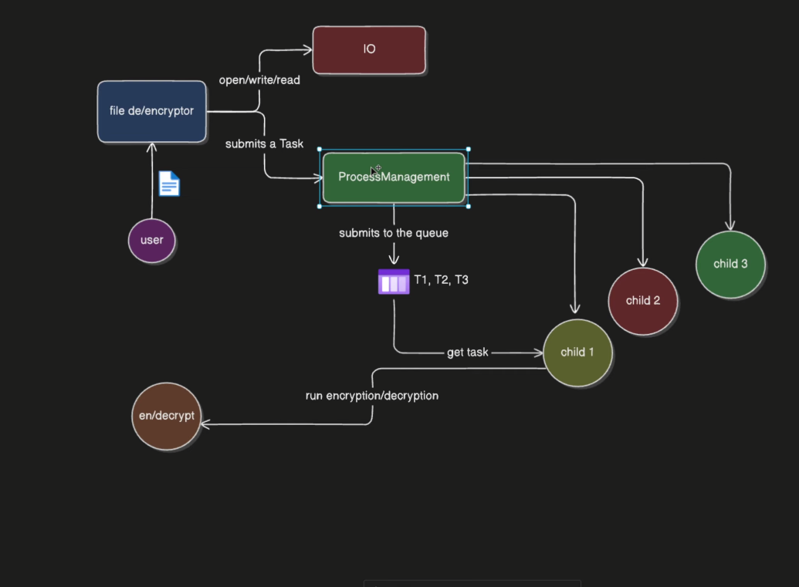

<div align="center">

# 🔐 Encrypt

### File encryption & decryption · C++17 · Systems programming

A hands-on C++ project exploring file I/O, task serialization, shared memory, and child processes through a reversible byte-shift transformation.


[Overview](#overview) · [Architecture](#architecture) · [Quick start](#quick-start) · [Usage](#usage) · [Project structure](#project-structure) · [Current limitations](#current-limitations)

</div>

---

> **Project status:** An educational systems-programming prototype. The standalone `cryption` executable supports single-file transformations. The directory-processing path has known synchronization and initialization issues; see [current limitations](#current-limitations) before running it.
>
> **Data handling:** Files are modified in place. Use disposable copies. The byte-shift algorithm is not suitable for protecting sensitive information.

## Overview

Encrypt brings together two parts of a file-processing application: a small transformation engine and a process-management layer intended to distribute file tasks across child processes.

The repository builds two executables:

| Executable | Purpose | Input |
| :--- | :--- | :--- |
| `cryption` | Transform one file directly | A quoted `file_path,ACTION` argument |
| `encrypt_decrypt` | Discover files recursively and submit processing tasks | Interactive directory and action prompts |

The project is useful for studying how C++ file streams, ownership transfer, POSIX processes, and interprocess communication fit together in a small codebase.

## Features at a glance

| Area | Implementation |
| :--- | :--- |
| **Recursive discovery** | Uses `std::filesystem::recursive_directory_iterator` to visit regular files in nested directories. |
| **Binary file access** | Opens files for binary reading and writing through an `IO` wrapper. |
| **Reversible transformation** | Adds or subtracts an integer key for each byte, wrapping modulo 256. |
| **Single-file execution** | Exposes the transformation engine through the `cryption` executable. |
| **Task serialization** | Encodes a file path and action as a comma-separated string. |
| **Shared-memory queue** | Defines a circular queue with 1,000 slots, each holding 256 characters. |
| **Process-management prototype** | Uses `fork()`, POSIX shared memory, and named semaphores; this path still needs fixes. |
| **Console timestamps** | Reports task submission and transformation completion times. |

## Architecture

The original project diagram illustrates the intended flow from user input to file access, task submission, and child-process execution.

<p align="center">
  
</p>

<p align="center"><em>Project architecture reference: file access → task queue → child processes → transformation.</em></p>

### How the pieces connect

1. **Collect input.** `main.cpp` prompts for a directory and an action.
2. **Discover files.** The application recursively visits regular files and opens them through `IO`.
3. **Create tasks.** Each `Task` carries a file path, stream, and `ENCRYPT` or `DECRYPT` action.
4. **Queue work.** `ProcessManagement` serializes tasks into a shared-memory circular queue.
5. **Start a child.** Each successful submission attempts to create a child process with `fork()`.
6. **Transform the file.** The child dequeues a task and calls `executeCryption()`, which reopens the file, reads the key, and updates its bytes in place.

The diagram represents the intended design. The current implementation creates a child per submission; it does not implement a fixed worker pool. The standalone `cryption` executable calls the transformation engine directly, bypassing the queue.

### Main components

| Component | Responsibility |
| :--- | :--- |
| [`main.cpp`](main.cpp) | Interactive input, directory traversal, task creation, and submission. |
| [`IO`](src/app/fileHandling/IO.hpp) | Binary read/write stream ownership and stream transfer. |
| [`ReadEnv`](src/app/fileHandling/ReadEnv.cpp) | Reads the contents of `.env` from the current working directory. |
| [`Task`](src/app/processes/Task.hpp) | Represents work and converts between objects and serialized task strings. |
| [`ProcessManagement`](src/app/processes/ProcessManagement.cpp) | Shared-memory queue setup, semaphore operations, forking, and task dispatch. |
| [`Cryption`](src/app/encryptDecrypt/Cryption.cpp) | Loads the key and performs the byte transformation. |
| [`CryptionMain`](src/app/encryptDecrypt/CryptionMain.cpp) | Single-file command-line entry point. |

## Quick start

### 1. Check prerequisites

Use a Linux environment with:

- A C++17-capable `g++` compiler.
- GNU Make.
- POSIX process, shared-memory, and semaphore support.

The process layer uses Linux/POSIX headers and APIs and is not a native Windows implementation. On Windows, use a Linux environment such as WSL.

```bash
g++ --version
make --version
```

### 2. Build the executables

Open a terminal in the repository root and run:

```bash
make -f MakeFile
```

> The build file is named **`MakeFile`**, with a capital `F`. Pass `-f MakeFile` explicitly; plain `make` does not discover that filename by default.

Successful compilation creates `encrypt_decrypt` and `cryption` in the repository root.

### 3. Set a demonstration key

Create a file named `.env` in the directory from which you will launch the executable. Its contents must be a plain integer, for example:

```text
7
```

This is a raw numeric file, not a `KEY=value` configuration file. If `.env` already exists, keep its value when decrypting files previously transformed with it. Do not commit a private key to GitHub.

For predictable demonstrations, use a key from **1 to 255**. A key of `0` leaves the bytes unchanged. The program currently does not validate the key range.

### 4. Try a single-file round trip

With `.env` configured, run these commands from the repository root:

```bash
# Create a disposable file and an unchanged comparison copy.
mkdir -p demo
printf 'Hello from Encrypt!\n' > demo/message.txt
cp demo/message.txt demo/message.original.txt

# Transform the file in place.
./cryption "demo/message.txt,ENCRYPT"

# Restore it using the same key.
./cryption "demo/message.txt,DECRYPT"

# Verify that the original contents were restored.
cmp demo/message.original.txt demo/message.txt && echo "Round trip successful"
```

The filename stays the same throughout. Encryption does not create a separate output file or add a new extension.

## Usage

### Single-file mode

```bash
./cryption "path/to/file,ENCRYPT"
./cryption "path/to/file,DECRYPT"
```

Pass the entire task as **one argument**, with a comma between the path and the uppercase action. Quoting supports paths containing spaces:

```bash
./cryption "demo/my notes.txt,ENCRYPT"
./cryption "demo/my notes.txt,DECRYPT"
```

Paths containing commas are not supported by the current task format. Use the exact action strings shown: the implementation interprets any action other than `ENCRYPT` as decryption.

### Directory mode — experimental

The interactive entry point is:

```bash
./encrypt_decrypt
```

It prompts for:

```text
Enter the directory path: /path/to/disposable-copies
Enter the action (encrypt/decrypt): encrypt
```

To request restoration, enter the same directory and `decrypt`, with the original key still configured.

This path recursively targets every regular file without extension filtering or exclusions. Use lowercase `encrypt` or `decrypt`; any input other than `encrypt` currently selects decryption. **The process-management issues listed below must be fixed before this mode can be relied on.**

Keep the target directory separate from the repository and `.env`: targeting the project itself can modify source files, executables, and the key file.

### Configuration reference

| Setting | Current behavior |
| :--- | :--- |
| Key location | `.env`, resolved relative to the process working directory. |
| Key format | Text parsed as an integer by `std::stoi`. Use only the numeric value. |
| Key access | The `IO` wrapper opens `.env` for both reading and writing, so it needs both permissions. |
| Output location | The original input file; no backup is created automatically. |
| File access | Target files must be readable and writable. |
| Restoration | Requires the same effective key and the corresponding reverse operation. |

## How the transformation works

For a byte value `b` and key `k`, the intended transformation is:

```text
Encrypt: E(b) = (b + k) mod 256
Decrypt: D(b) = (b - k + 256) mod 256
```

For example, with a key of `7`, the ASCII byte for `A` changes from `65` to `72`, which represents `H`. Decryption reverses that shift.

The implementation reads one byte at a time, moves the write position back, and overwrites that byte. It preserves file length, but transformed files may contain non-printable bytes.

This is a simple additive byte cipher with only 256 effective shifts. It provides no authentication, integrity checking, or wrong-key detection. It is an educational transformation, not modern cryptographic protection.

## Project structure

```text
encrypt/
├── README.md
├── MakeFile                         # Builds both executables
├── main.cpp                         # Interactive directory entry point
├── .env                             # Local numeric key; create/configure locally
├── docs/
│   └── assets/
│       └── architecture.png         # Architecture reference shown above
└── src/
    └── app/
        ├── encryptDecrypt/
        │   ├── Cryption.hpp         # Transformation function declaration
        │   ├── Cryption.cpp         # In-place byte transformation
        │   └── CryptionMain.cpp     # Single-file executable entry point
        ├── fileHandling/
        │   ├── IO.hpp              # File-stream wrapper interface
        │   ├── IO.cpp              # Binary file access implementation
        │   └── ReadEnv.cpp         # Local key-file reader
        └── processes/
            ├── Task.hpp            # Task model and serialization
            ├── ProcessManagement.hpp
            └── ProcessManagement.cpp
```

### Build commands

| Command | Result |
| :--- | :--- |
| `make -f MakeFile` | Build both executables. |
| `make -f MakeFile cryption` | Build only the standalone file transformer. |
| `make -f MakeFile encrypt_decrypt` | Build only the interactive directory application. |
| `make -f MakeFile clean` | Remove generated object files and executables. |

The build enables C++17, debug symbols, and compiler warnings through `-std=c++17 -g -Wall`.

## Current limitations

These details describe the current source and distinguish the intended architecture from its working parts.

| Area | Limitation |
| :--- | :--- |
| Semaphore initialization | Constructor-local semaphore pointers shadow the class members. Queue methods use the uninitialized members, which can cause crashes or undefined behavior. |
| Queue synchronization | The queue uses a regular `std::mutex`, which does not provide mutual exclusion between the forked processes. |
| Child lifecycle | The parent does not wait for or collect child exit statuses, so its exit does not confirm successful processing of every file. |
| IPC lifecycle | Named semaphores are not closed or unlinked, and the shared-memory descriptor is not explicitly closed. Fixed IPC names can also collide across runs. |
| Task storage | Queue entries hold 256 characters and are copied without a bounds check. Serialized tasks must fit within 255 bytes plus the terminating null byte. |
| Input validation | Invalid actions fall back to decryption; malformed keys can throw uncaught exceptions. IPC calls also lack comprehensive failure checks. |
| Recovery | Processing overwrites the source file without a backup or an atomic replacement step. An interruption can leave a partially transformed file. |
| Cryptography | The byte-shift cipher does not provide meaningful confidentiality or detect altered data. |

### Verification scope

During README preparation, both executables compiled successfully in a temporary copy of the project. A standalone round-trip check used a 1,024-byte sample containing every byte value from `0` through `255`, repeated four times, with key `7`.

That check confirmed that encryption changed the bytes according to the expected shift and decryption restored the original sample. It does not validate the directory-processing path or establish cryptographic security. The repository currently has no automated test suite.

## Troubleshooting

| Symptom | What to check |
| :--- | :--- |
| `make` cannot find a build file | Use `make -f MakeFile` from the repository root. |
| `Unable to open file: .env` | Put the numeric key file in the current working directory and check read/write permissions. |
| An exception mentions `stoi` | Ensure `.env` contains a valid integer rather than `KEY=value` or an empty value. |
| `Unable to open file: ...` | Check the target path and confirm the file is readable and writable. |
| Decryption does not restore readable content | Check that the key matches and that the file has undergone the corresponding number of encrypt/decrypt operations. |
| Directory mode crashes, stalls, or exits before work completes | Review the process-management limitations. Use standalone mode for isolated demonstrations. |

## Possible next steps

- [ ] Fix semaphore member initialization and check all IPC return values.
- [ ] Use process-shared synchronization and explicit IPC resource cleanup.
- [ ] Add a bounded worker pool and collect child completion statuses.
- [ ] Validate actions, key values, task lengths, and serialized paths.
- [ ] Add output-file support or atomic replacement with recovery behavior.
- [ ] Add automated tests for binary round trips, failure paths, and concurrent processing.
- [ ] Replace the byte-shift cipher with authenticated encryption through an established cryptographic library if secure storage becomes a goal.

## Contributing

Keep changes focused and include a short explanation of the behavior they improve. Build with `make -f MakeFile`, verify transformations using disposable files, and document any changes to the task format, key configuration, or process lifecycle.

For process-management changes, include evidence that concurrent tasks finish correctly and that IPC resources are cleaned up after both success and failure.

---

<p align="center"><strong>Explore the systems. Understand the bytes. Build on the foundations.</strong></p>
